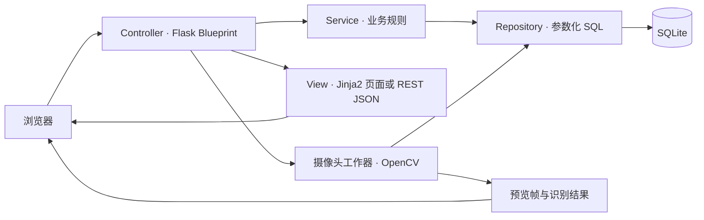
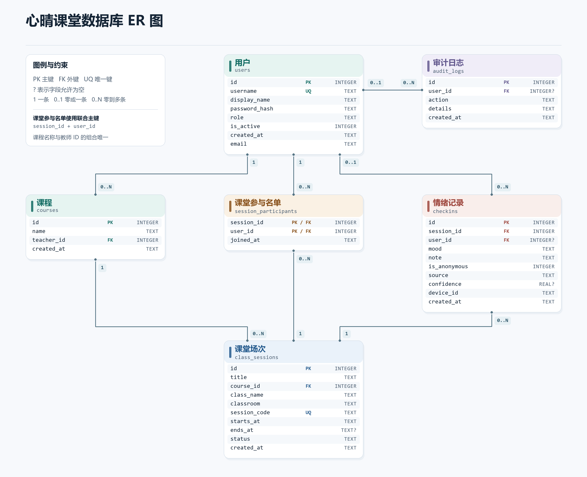

# 心晴课堂系统设计

## 系统架构与修改版 MVC

- **Controller** 接收 HTML 和 REST 请求，解析参数，组织页面或 JSON 响应。
- **Model** 由 `services.py`、`repository.py` 和 SQLite 共同实现。Service 统一课堂归属、名单、反馈、统计、导出和事务规则。Repository 封装参数化 SQL。
- **View** 通过 Jinja2 渲染桌面和移动页面，JavaScript 更新图表、教学建议和摄像头预览。REST 入口复用同一业务层，通过 JSON 返回数据。

接口路径与字段见 [API 文档](api.md)。服务端校验角色、资源归属和页面写操作的 CSRF。匿名人工反馈保留本人历史关联，教师页面和 CSV 中显示为「匿名同学」。

## 数据库设计

| 表 | 用途 |
| --- | --- |
| `users` | 账号、角色、状态和密码哈希 |
| `courses` | 课程名称与授课教师 |
| `class_sessions` | 课堂主题、课堂代码、时间、班级、教室和状态 |
| `session_participants` | 用户与课堂的多对多参与关系 |
| `checkins` | 情绪、时间、备注、来源及识别置信度 |
| `audit_logs` | 记录指定接口的操作和时间 |

课堂通过 `class_sessions.course_id` 外键关联课程。启动时由 `emotion_checker/db.py` 初始化结构，并按课程名和教师关联旧版课堂，保留原课堂 ID 及关联记录。每次采样或打卡生成独立反馈，保留时间变化。

## 实时摄像头识别

教师在开放课堂启动识别。OpenCV 读取本机摄像头，YuNet 检测人脸及关键点，MobileFaceNet 对对齐后的人脸分类。看板实时展示画面、人脸框、情绪和置信度。系统约每 3 秒采样一次，达到 0.65 阈值的结果匿名写入当前课堂。数据库保存类别、时间、置信度和设备标识。

| 模型原生表情 | 课堂情绪 |
| --- | --- |
| `happy` 开心 | `happy` 开心 |
| `neutral` 中性 | `calm` 平静 |
| `surprised` 惊讶 | `confused` 困惑 |
| `sad` 悲伤 | `tired` 疲惫 |
| `fearful` 害怕 | `anxious` 焦虑 |
| `angry` 生气 | `anxious` 焦虑 |
| `disgust` 厌恶 | `distracted` 分心 |

### 模型来源

项目模型权重采用 OpenCV Zoo 版本 `48b10fa505aeb51fbd127fc60a5c660040e823b7`.

- `face_detection_yunet_2023mar.onnx`, MIT, copyright 2020 Shiqi Yu. [YuNet source](https://github.com/opencv/opencv_zoo/tree/48b10fa505aeb51fbd127fc60a5c660040e823b7/models/face_detection_yunet)
- `facial_expression_recognition_mobilefacenet_2022july.onnx`, Apache 2.0. The OpenCV Zoo inference demo credits the Shenzhen Institute of Artificial Intelligence and Robotics for Society (2022). [Expression model source](https://github.com/opencv/opencv_zoo/tree/48b10fa505aeb51fbd127fc60a5c660040e823b7/models/facial_expression_recognition)

模型许可文本见项目根目录的 `models/`。
