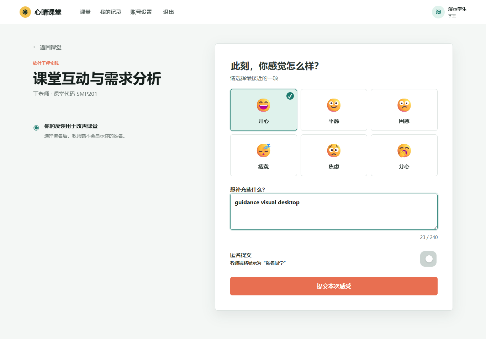
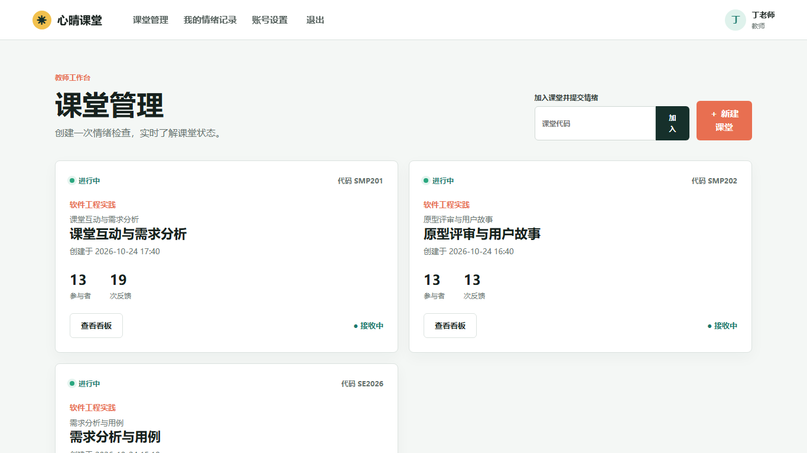
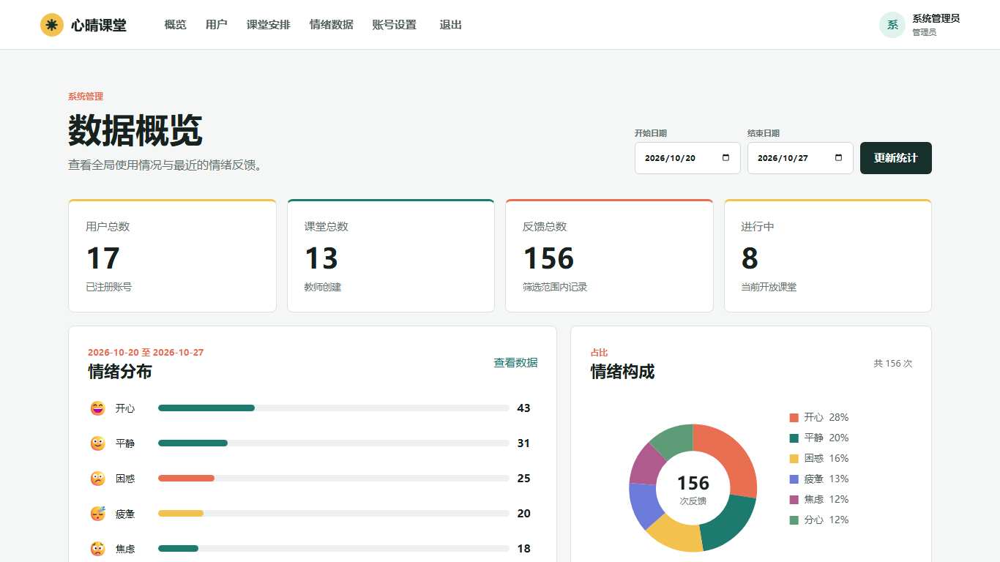

# 心晴课堂实验报告

课程为软件工程实践。报告日期为 2026 年 11 月 10 日。

## 项目目标

心晴课堂面向课堂即时反馈场景。学生记录当下感受，教师结合分布、趋势和教学建议观察课堂，管理员按课程、班级和时间统计及导出数据。项目采用 Flask、SQLite、Jinja2 和原生 JavaScript，实现浏览器端三类角色操作与 REST 接口。

## 主要功能

### 学生反馈

学生通过课堂列表或课堂代码进入课堂，可选择开心、平静、困惑、疲惫、焦虑或分心，补充说明并选择匿名提交。个人记录页按提交顺序展示情绪变化和反馈明细。

### 教师课堂

教师可创建、预约、结束或重新开放自己的课堂。看板聚合反馈分布和时间趋势，显示最近反馈，并根据最近一分钟的情绪记录更新教学建议。反馈明细支持按学生和时间查看，课堂记录可导出为 CSV。

### 管理员统计

管理员维护账号及课堂参与名单，按课程、班级和时间查看情绪分布、变化趋势及反馈明细。统计概览和数据明细可沿用筛选条件，导出同一范围内的记录。

图中展示 2026 年 10 月 20 日至 27 日筛选范围内的 156 条反馈。

## 设计与数据流程

页面和 REST 请求由 Flask Blueprint 接收，Service 负责业务校验与事务，Repository 访问 SQLite。课堂通过课程 ID 关联课程，参与关系连接用户与课堂，反馈关联具体课堂与提交时间。整体架构、修改版 MVC 和 ER 图见 [系统设计](architecture.md)。

## 实时识别与结果使用

教师在开放课堂点击「开始识别」，页面显示本机摄像头画面、人脸框、情绪和置信度。OpenCV 调用 YuNet 和 MobileFaceNet 完成人脸检测与表情分类，输出统一映射为课堂的六类情绪。

系统约每 3 秒选取一次采样，达到 0.65 置信度阈值的结果匿名计入当前课堂。教师将采样与学生主动反馈一起查看，结合最近反馈和时间趋势观察课堂变化。结束识别或课堂时，系统释放摄像头。

## 验证结果

2026 年 11 月 10 日运行 29 项自动化测试，全部通过。摄像头集成测试覆盖预览、匿名入库与课堂结束后释放摄像头。课程外键迁移测试验证旧课堂 ID 及其关联数据得到保留。功能用例、性能数据和页面验收结果见 [测试报告](test-report.md)。

## 运行与演示

按 [部署说明](../README.md#快速运行) 安装依赖并启动服务，按 [用户手册](用户手册.md) 展示学生打卡、教师查看趋势并开启识别、管理员筛选和导出。

## 资料依据

- 《软件工程00 简介》课件。
- 《表情符号课堂情绪检查器系统》实验指导书。
- 项目源码、自动化测试及页面验收记录。
